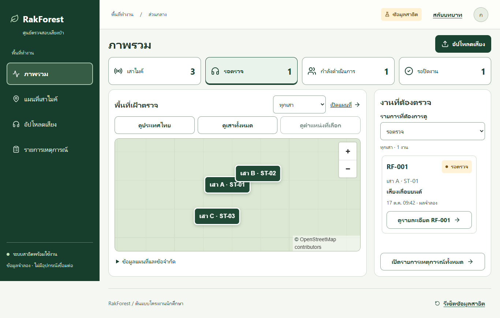

# RakForest 🌳

**ผู้พัฒนาส่วน Web App: ทีม**

README นี้แนะนำส่วนเว็บที่ทีมพัฒนา และวิธีใช้งานสำหรับเพื่อนในกลุ่ม เครดิตนี้ครอบคลุมงาน Web App ส่วนโมเดล ML และงานส่วนอื่นของเพื่อนมีผู้รับผิดชอบแยกตามหน้าที่

เว็บต้นแบบสำหรับ **ตรวจเสียงจากเสาไมค์ในป่า และประสานงานเจ้าหน้าที่ภาคสนาม** พัฒนาในขอบเขตโครงงานนักศึกษา

| ใครใช้งาน | ทำอะไรได้ |
| --- | --- |
| เจ้าหน้าที่ส่วนกลาง | ดูภาพรวม/แผนที่ จัดการเสา อัปโหลดเสียง ตรวจผล ส่งงาน และปิดงาน |
| เจ้าหน้าที่ภาคสนาม | ดูงานของตน รับทราบ และส่งผลพร้อมภาพประกอบ |



ภาพเป็นข้อมูลสาธิตและใช้พื้นแผนที่ทดแทนระหว่างทดสอบ เว็บที่เปิดใช้งานปกติใช้แผนที่ฐาน OpenStreetMap

## 1. เริ่มรันเว็บ

เตรียม **Node.js 24.x** จาก [nodejs.org](https://nodejs.org/) และติดตั้ง pnpm รุ่นเดียวกับโครงการ:

```sh
npm install -g pnpm@11.25.0
```

เปิด Terminal ในโฟลเดอร์โครงการ แล้วรัน:

```sh
pnpm install --frozen-lockfile
pnpm dev
```

เปิด **http://127.0.0.1:3000/login** แล้วเลือกบทบาทได้เลย เปิด Terminal ค้างไว้ระหว่างใช้งาน และกด `Ctrl+C` เมื่อต้องการหยุดเว็บ

**เริ่มต้นได้โดยไม่ต้องมีโมเดล API key หรือไฟล์ .env** เพราะค่าเริ่มต้นคือ `mock` ซึ่งให้ผลจำลองตามเสาที่เลือก

บน Windows หลังติดตั้ง dependencies แล้ว สามารถดับเบิลคลิก [start-rakforest.cmd](start-rakforest.cmd) แทน `pnpm dev` ได้ ไม่ต้องติดตั้ง Codex

## 2. ลองใช้งานตั้งแต่เริ่มจนจบ

1. เลือก **เจ้าหน้าที่ส่วนกลาง** → **อัปโหลดเสียง** → เลือกเสาและไฟล์เสียง → **ส่งวิเคราะห์จำลอง**
2. กด **เปิดผล** → ตรวจเสียงและคะแนน → **ส่งงานและแจ้ง Telegram จำลอง**
3. ถ้ายังไม่เชื่อม Telegram จำลอง ข้อความจะล้มเหลว แต่งานยังถูกบันทึกไว้ตามปกติ
4. กด **สลับบทบาท** → เลือก **เจ้าหน้าที่ภาคสนาม** → **เชื่อม Telegram จำลอง** → **จำลองกด Start**
5. สลับกลับส่วนกลาง เปิดงานเดิมแล้วกด **ลองส่งข้อความใหม่** เพื่อทดลองกรณีส่งสำเร็จ
6. กลับภาคสนาม เปิดงาน → **รับทราบงาน** → **ส่งผลตรวจสอบ** → เลือกผลและแนบภาพได้
7. กลับส่วนกลาง เปิดงาน → กรอก **เหตุผลปิดงาน** → **ตรวจผลและปิดงาน**

ใช้เครื่อง เบราว์เซอร์ profile และ URL เดิมตลอดการทดลอง ข้อมูลอยู่ใน IndexedDB ของเบราว์เซอร์ การเปลี่ยนบทบาทไม่ลบงาน แต่ปุ่ม **รีเซ็ตข้อมูลสาธิต** จะล้างงานและไฟล์ที่เพิ่มไว้

## 3. อะไรใช้ได้แล้ว และอะไรยังจำลอง

| ส่วน | สถานะตอนนี้ |
| --- | --- |
| เว็บสองบทบาทและขั้นตอนส่งงาน | ทดลองครบเส้นทางได้ในเครื่องเดียว |
| ข้อมูลและไฟล์ | เก็บจริงในเบราว์เซอร์ ยังไม่แชร์ผ่านฐานข้อมูลกลาง |
| ML แบบ mock | ให้ผลคงที่ตามเสา ไม่ได้วิเคราะห์เนื้อหาไฟล์จริง |
| ML ผ่าน HTTP API | ตัวเชื่อมพร้อมใช้ รอ API และโมเดลของเพื่อนตาม [สัญญาที่ตกลง](docs/ml-integration.md) |
| คะแนนแต่ละประเภทเสียง | รองรับ score แยกหลายคลาสจาก API; `label` บนสุดยังเป็นคลาสคะแนนสูงสุดเพื่อสรุป คะแนนไม่ยืนยันเหตุ |
| Telegram | จำลองข้อความ/สถานะ ยังไม่ส่งถึงมือถือจริง |
| บัญชีผู้ใช้ | เลือกบทบาทสาธิต ยังไม่มี Login หรือสิทธิ์ฝั่งเซิร์ฟเวอร์จริง |
| แผนที่ | ฐาน OpenStreetMap และขอบเขตประเทศไทยจากข้อมูลภายนอก ดู [แหล่งที่มา](public/data/README.md) |
| เสาไมค์ | เริ่มด้วยเสาสาธิต 3 จุด เพิ่ม/แก้ไขในประเทศไทยได้ ยังไม่เชื่อมฮาร์ดแวร์ |

วงเริ่มต้น 300 เมตรเป็น **รัศมีรับเสียงโดยประมาณที่ยังไม่ทดสอบภาคสนาม** ไม่ใช่ตำแหน่งต้นเสียง และไม่ได้คำนวณจากคะแนนโมเดล ส่วนกลางเป็นผู้ตัดสินใจส่งงาน

## 4. เพื่อนในกลุ่มเริ่มตรงไหน

| ฝ่าย | จุดเริ่มต้น |
| --- | --- |
| Frontend (ทีม) | [คู่มือสำหรับเพื่อนในกลุ่ม](docs/group-guide.md): หน้าจอ โครงสร้างไฟล์ ข้อมูล และการทดสอบ |
| ผู้รับผิดชอบโมเดล ML | [คู่มือเชื่อมโมเดล](docs/ml-integration.md): สิ่งที่ต้องส่งให้ทีม (ผู้พัฒนาเว็บ) ตัวอย่าง API และ preprocessing |
| ผู้รับผิดชอบ Backend / ผู้เชื่อมระบบ | [งานที่ยังต้องเชื่อม](docs/group-guide.md#งานที่ยังต้องเชื่อม): ฐานข้อมูล บัญชี Telegram และการเก็บไฟล์ |
| ผู้เตรียม GitHub | [คู่มือเตรียมขึ้น GitHub](docs/github-preparation.md): ตรวจไฟล์และคำสั่งสำหรับอัปโหลดภายหลัง |

> การนำไฟล์โมเดลมาวางในเว็บอย่างเดียวยังใช้ไม่ได้ ต้องมีบริการที่โหลดโมเดลและตอบตาม API ก่อน โหมด `http` ตั้งค่าฝั่งเซิร์ฟเวอร์ตามคู่มือ ML

## 5. คำสั่งที่ใช้บ่อย

| คำสั่ง | ใช้เมื่อ |
| --- | --- |
| `pnpm dev` | เปิดเว็บสำหรับพัฒนา บนพอร์ต 3000 |
| `pnpm typecheck` | ตรวจ TypeScript |
| `pnpm build` | สร้าง production build |
| `pnpm start` | เปิด production build หลังรัน build แล้ว |
| `pnpm test` | รันชุดทดสอบหลัง build ใช้ Edge และเว็บทดสอบพอร์ต 3100 |

[วิธีทดสอบและข้อกำหนดเครื่อง](docs/group-guide.md#ทดสอบก่อนส่งงาน) · [ผลตรวจล่าสุด](docs/VERIFICATION.md)

## 6. ปัญหาที่พบบ่อย

- **หา node/npm/pnpm ไม่เจอ:** ติดตั้ง Node.js แล้วเปิด Terminal ใหม่ จากนั้นติดตั้ง pnpm ตามข้อ 1
- **เปิดเว็บไม่ได้:** ตรวจว่า Terminal ยังทำงานและไม่มีข้อความผิดพลาด เปิด URL ที่ Terminal แสดง โดยใช้ `/login` ต่อท้าย
- **พอร์ต 3000 ถูกใช้:** ใช้ `pnpm dev --port 3001` แล้วเปิด `http://127.0.0.1:3001/login` ข้อมูลเดิมจากพอร์ต 3000 จะไม่ตามมา เพราะเป็นพื้นที่เก็บข้อมูลคนละ origin
- **แต่ละคนเห็นงานไม่เหมือนกัน:** เป็นพฤติกรรมปัจจุบัน ข้อมูลอยู่ในแต่ละเบราว์เซอร์ ไม่ได้ซิงก์ผ่าน GitHub รวมถึง `localhost` กับ `127.0.0.1` ใช้ข้อมูลคนละชุด
- **เปลี่ยนไฟล์เสียงแล้วผลเหมือนเดิม:** ตรวจป้ายผลจำลอง โหมด mock ใช้เสา A = เลื่อยยนต์, B = ยานพาหนะ, C = ไฟ เสาใหม่ใช้ผลเลื่อยยนต์ ต้องเชื่อม API จริงจึงวิเคราะห์เนื้อหาเสียง
- **แผนที่ไม่ขึ้น:** แผนที่ฐานต้องใช้อินเทอร์เน็ต ยังเลือกเสาจากรายการและใช้ส่วนอื่นได้

## เอกสารและภาพเพิ่มเติม

- [รวมเอกสารปัจจุบันและเอกสารอ้างอิงเก่า](docs/README.md)
- [ภาพหน้าจอปัจจุบันและคำอธิบาย](docs/ui-accessibility/README.md) — ไฟล์ HTML แกลเลอรีต้องดาวน์โหลด/เปิดในเบราว์เซอร์ GitHub ไม่รัน HTML ให้ในหน้าไฟล์
- [ค่าตัวอย่างสำหรับเชื่อมบริการ](.env.example) — ไม่ใส่ค่าลับลงไฟล์นี้

กลุ่มยังไม่ได้กำหนด LICENSE สำหรับโค้ดโครงการ ส่วนสิทธิ์ข้อมูลแผนที่และองค์ประกอบภายนอกคงตามเจ้าของเดิม
