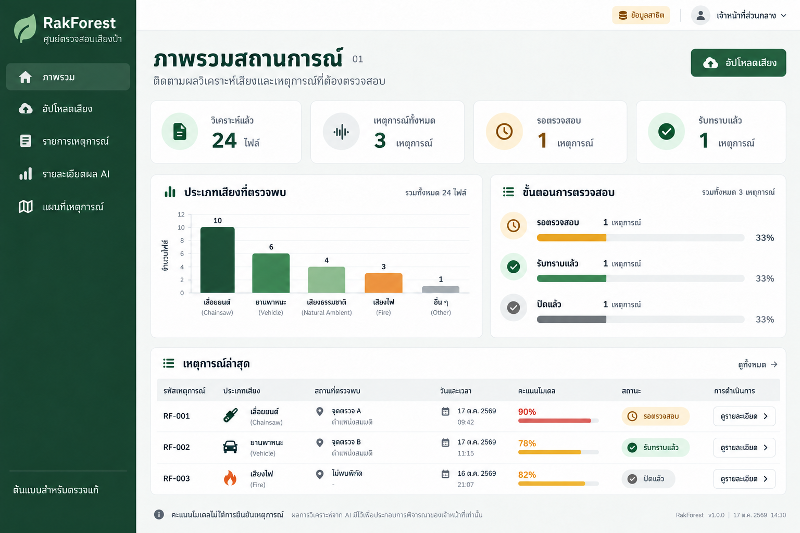
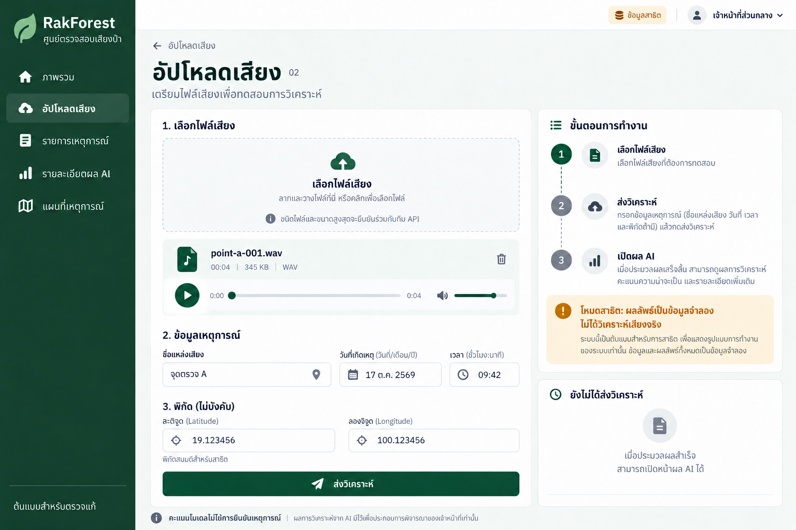
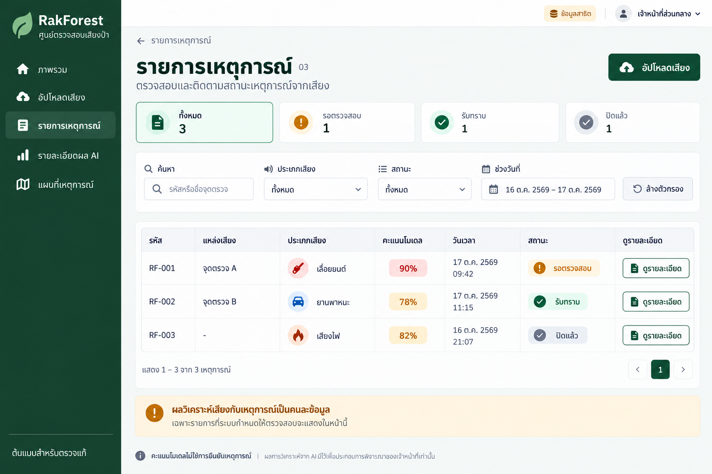
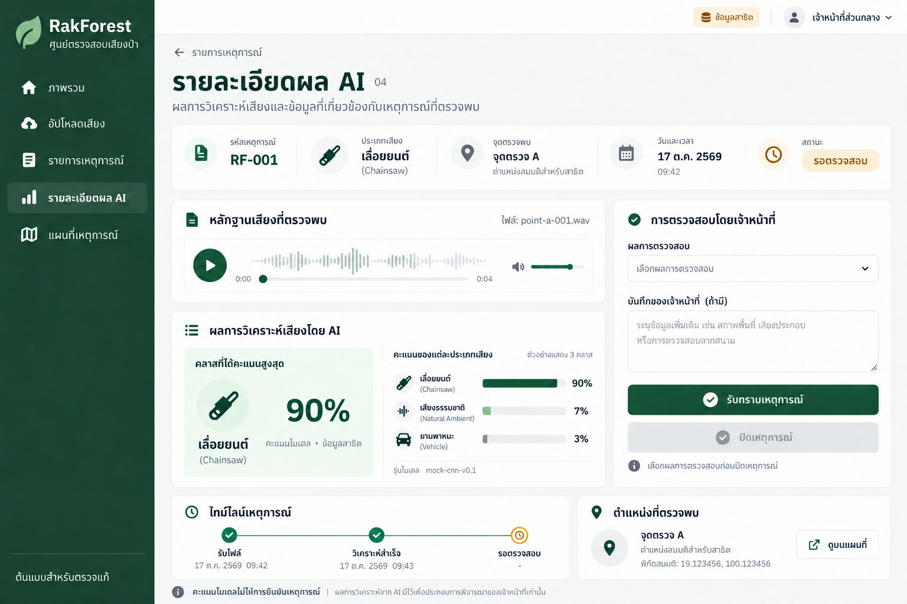
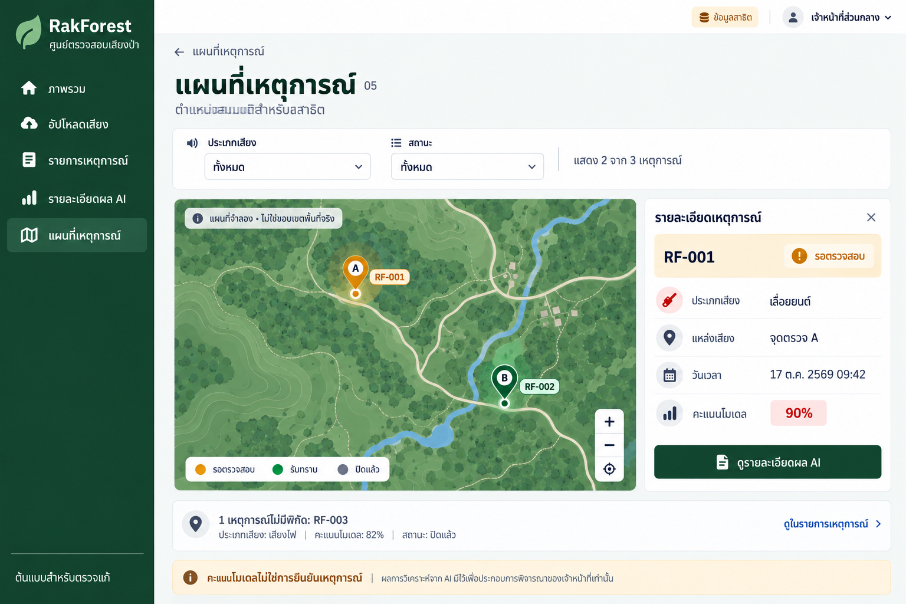

# RakForest — ภาพต้นแบบและแผนพัฒนา v1

วันที่ 17 ตุลาคม 2569 • สถานะ: รอตรวจแก้ภาพก่อนเริ่มเขียนเว็บ

ส่งมอบรอบนี้: ภาพ PNG 5 หน้าและแกลเลอรีพร้อมคำอธิบาย ยังไม่ใช่แอปที่ทำงานจริง และยังไม่ได้เชื่อม API/โมเดล ภาพสร้างด้วย built-in imagegen ไม่ใช้ CLI

## เส้นทางหลัก

02 อัปโหลด → งานวิเคราะห์ → 04 ผลจำแนก → รับทราบ/ปิดเหตุการณ์ → 01 ภาพรวม / 03 รายการ / 05 แผนที่

ผลจำแนกมีได้โดยไม่มีเหตุการณ์: หน้า 04 ต้องแสดงผลได้และซ่อนส่วนจัดการเหตุการณ์เมื่อไม่มี alert ผูกอยู่ เมนูรายละเอียดในภาพมีไว้ช่วยรีวิว; เว็บจริงเข้าผ่านรายการหรือผลอัปโหลด ไม่เปิดรหัสเริ่มต้นแทนผู้ใช้

## 01 ภาพรวม

สรุปไฟล์ที่วิเคราะห์แล้ว 24 ไฟล์ และเหตุการณ์ 3 รายการ แยกสถานะรอตรวจสอบ รับทราบ และปิดแล้วอย่างละ 1 รายการ

**การใช้งาน:** อัปโหลดเสียง → 02; ดูทั้งหมด → 03; ดูรายละเอียดแถวที่เลือก → 04

**สถานะเพิ่มเติม:** Loading: โครงร่าง KPI/กราฟ; Empty: ตัวเลข 0 และชวนอัปโหลด; Error: แจ้งโหลดไม่สำเร็จและปุ่มลองใหม่

## 02 อัปโหลดเสียง

เลือกไฟล์ ฟังตัวอย่าง ระบุแหล่งเสียงและเวลา พร้อมพิกัดถ้ามี ขณะนี้เป็นภาพก่อนกดส่ง

**การใช้งาน:** ส่งวิเคราะห์ → รอประมวลผล → กำลังประมวลผล → สำเร็จ → เปิดผล 04; ล้มเหลว → ลองใหม่

**สถานะเพิ่มเติม:** Loading: ปิดปุ่มส่งซ้ำและแสดงสถานะงาน; Empty: ยังไม่มีไฟล์และส่งไม่ได้; Error: ชี้ข้อผิดพลาดไฟล์/พิกัด/บริการ เก็บข้อมูลฟอร์มไว้

## 03 รายการเหตุการณ์

ค้นหาเหตุการณ์และกรองด้วยประเภทเสียง สถานะ และวันที่ ข้อมูลตั้งต้น RF-001 / RF-002 / RF-003

**การใช้งาน:** ดูรายละเอียด → 04; อัปโหลดเสียง → 02; ล้างตัวกรอง → แสดงทุกรายการ

**สถานะเพิ่มเติม:** Loading: โครงร่างตาราง; Empty: แยกระหว่างยังไม่มีเหตุการณ์กับไม่พบผลตามตัวกรอง; Error: โหลดไม่สำเร็จและลองใหม่

## 04 รายละเอียดผล AI

ฟังเสียง ตรวจคะแนนโมเดล รุ่นโมเดล และประวัติ ก่อนบันทึกผลตรวจสอบโดยเจ้าหน้าที่ ภาพแสดง RF-001 ที่ยังรอตรวจสอบ

**การใช้งาน:** รับทราบ → เปลี่ยนสถานะและเพิ่มประวัติ; เลือกยืนยันเหตุ/แจ้งเตือนผิด/ข้อมูลไม่เพียงพอ → ปิดเหตุการณ์; ดูบนแผนที่ → 05

**สถานะเพิ่มเติม:** Loading: โครงร่างรายละเอียด; Empty: ไม่พบรหัส หรือผลยังไม่พร้อม; Error: เล่นเสียงหรือบันทึกไม่สำเร็จ ให้ลองใหม่โดยไม่แสดงว่าบันทึกสำเร็จ

## 05 แผนที่เหตุการณ์

แสดงเฉพาะ 2 รายการที่มีพิกัด โดยหมุดใช้สีสถานะการตรวจสอบ RF-003 ไม่มีพิกัดจึงไม่สร้างหมุด

**การใช้งาน:** เลือกหมุด → แผงข้อมูล; ดูรายละเอียดผล AI → 04; รายการไม่มีพิกัด → 03

**สถานะเพิ่มเติม:** Loading: โหลดแผนที่/หมุด; Empty: ไม่มีรายการที่มีพิกัดตามตัวกรอง; Error: แผนที่โหลดไม่ได้ยังเปิดรายการเหตุการณ์ได้

## ข้อมูลและข้อตกลงสำหรับพัฒนา

- React + TypeScript + Vite, CSS Modules; แยก mock service ออกจาก component ไม่มีการเชื่อมบริการจริงในระยะภาพต้นแบบ
- Prediction: id, recordedAt (ISO พร้อม timezone), sourceId/name, modelVersion, predictedLabel, scores (ชื่อคลาส → ค่า 0–1), audio reference, optional coordinates และ isDemo
- AnalysisJob: id, status (queued / processing / succeeded / failed), predictionId เมื่อสำเร็จ และข้อความผิดพลาดเมื่อไม่สำเร็จ
- Alert: id, predictionIds, createdAt, reason, status (pending / acknowledged / closed), reviewOutcome, notes, history และเวลารับทราบ/ปิด
- ReviewOutcome: confirmed / false_alarm / insufficient_information; ต้องเลือกก่อนปิด ไม่บังคับว่าต้องรับทราบก่อนปิด ส่วนบันทึกข้อความเป็นทางเลือก
- Service interface ที่ต้องมี: submitAudio, getJob, getPrediction, listAlerts, getAlert, acknowledgeAlert, closeAlert; ตกลง HTTP endpoints กับทีม Backend ก่อนเชื่อมจริง
- หน้าเว็บวนแสดง scores ตามข้อมูล ไม่ฝังจำนวนคลาส 3 หรือ 10 ตายตัว ภาพแสดงเพียงตัวอย่าง 3 คลาส
- Backend เป็นผู้สร้างเหตุการณ์และกำหนด reason; frontend ไม่ใช้คะแนนคำนวณความเสี่ยงเอง
- ข้อมูลทุกหน้ามาจาก store/service เดียวกัน เมื่อเปลี่ยนสถานะต้อง refresh ภาพรวม รายการ รายละเอียด และแผนที่
- บันทึกเวลาเป็น ISO แสดงผล Asia/Bangkok; ไม่เติมพิกัดเมื่อไม่มีข้อมูล พิกัดที่กรอกต้องเป็นคู่และอยู่ในช่วงละติจูด/ลองจิจูดที่ถูกต้อง
- mock job ใช้ polling และหยุดเมื่อสำเร็จ/ล้มเหลวหรือออกจากหน้า; ป้องกันส่งซ้ำระหว่างงานกำลังส่ง/ประมวลผล
- สีคะแนนในภาพเป็นงานตกแต่ง ไม่ใช่เกณฑ์เสี่ยงที่ตกลงแล้ว เว็บจริงใช้สีคะแนนกลาง ๆ และแสดงสถานะด้วยทั้งข้อความและสี

## ลำดับงานต่อจากการตรวจภาพ

1. ปรับภาพตามข้อเสนอแนะและสรุปข้อความ/เมนูสุดท้าย
2. ตั้ง React + TypeScript + Vite และโครง shared layout / types / services / mock fixtures
3. ทำรายการและรายละเอียดก่อน เพื่อทดสอบการเปลี่ยนสถานะร่วมกัน แล้วเพิ่มหน้าอัปโหลดจำลอง Dashboard และแผนที่
4. เพิ่ม loading / empty / error และทดสอบขนาดหน้าจอรวมถึง keyboard navigation
5. ประสาน Backend/ML: รูปแบบไฟล์ ขนาด/ความยาวสูงสุด preprocessing รายชื่อคลาส API งานวิเคราะห์ การจัดเก็บเสียง และกติกาสร้างเหตุการณ์
6. เปลี่ยน service adapter เป็น API จริง ทดสอบทั้งเส้นทางด้วยไฟล์เสียงจริง พร้อมแสดงข้อผิดพลาดและสถานะโมเดลไม่พร้อม

ไม่เริ่มพัฒนาเว็บก่อนรอบตรวจแก้ภาพตามลำดับที่ตกลง ยังไม่รวม Login จริง ผู้ใช้ โซน การแจ้งเตือนภายนอก Mobile PWA หรือ offline

## เกณฑ์ตรวจรับเว็บในขั้นถัดไป

- อัปโหลด → ประมวลผล → ผลจำแนก; ถ้าไม่มี alert ยังดู prediction ได้
- รับทราบ/ปิดแล้วสถานะและตัวเลขตรงกันทุกหน้า ไม่เพิ่มเหตุการณ์ซ้ำจากการกดซ้ำ
- ทดสอบไฟล์ไม่รองรับตาม API ที่ตกลง ไม่เลือกไฟล์ พิกัดไม่ครบ งานล้มเหลว และลองใหม่
- ทดสอบข้อมูลว่าง ตัวกรองไม่พบรายการ รหัสไม่พบ และไม่วางหมุดรายการไร้พิกัด
- API บันทึกล้มเหลวต้องไม่แสดงว่าสำเร็จ และการออกจากหน้าต้องหยุด polling
- ข้อมูลจำลองต้องติดป้ายเสมอ ไม่แสดงว่าระบบจำแนกเสียงจริงแล้ว

## บันทึกตรวจภาพรอบนี้

ตรวจภาพทั้ง 5 หน้าแล้ว: RF-001 คะแนน90% รอตรวจสอบสอดคล้องกัน; RF-002 78% รับทราบ; RF-003 82% ปิดแล้วและไม่มีหมุด; Dashboard มี24ไฟล์และ3เหตุการณ์; แผนที่มี2หมุด แก้ข้อความขนาดไฟล์ที่เครื่องมือเติมเองและลบการอ้างหน่วยงานที่ไม่ได้ยืนยันแล้ว

ภาพเป็น raster สำหรับตรวจเลย์เอาต์ ตัวสะกด/ไอคอน/ระยะเล็กน้อยอาจต่างกันระหว่างหน้า ข้อความในเอกสารนี้เป็นหลักสำหรับพัฒนา กราฟคลาสในภาพเป็นข้อมูลสาธิต ไม่ใช่จำนวนคลาสสุดท้ายของโมเดล

เสนอแก้ได้ด้วยรูปแบบ: หน้า 02 / ตำแหน่งหรือองค์ประกอบ / สิ่งที่ต้องการเปลี่ยน / เหตุผล

