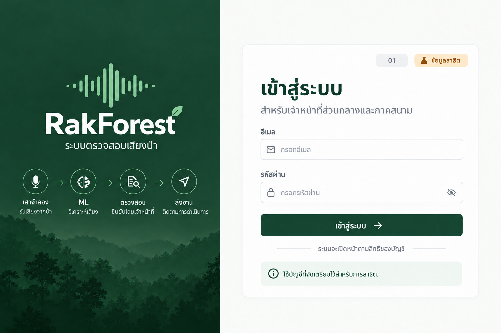
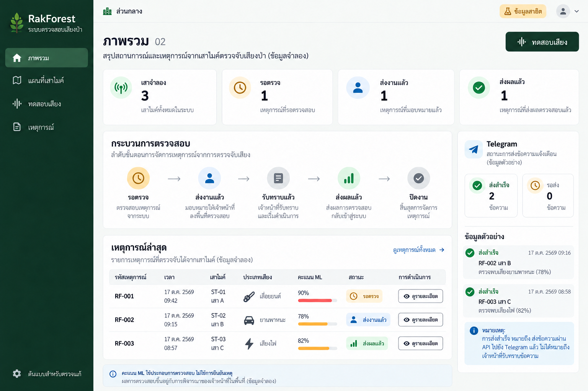
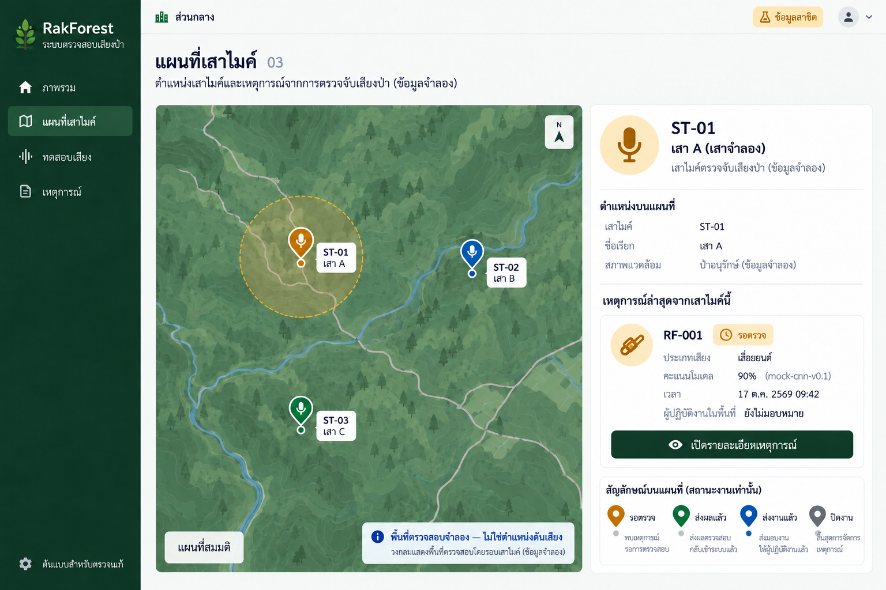
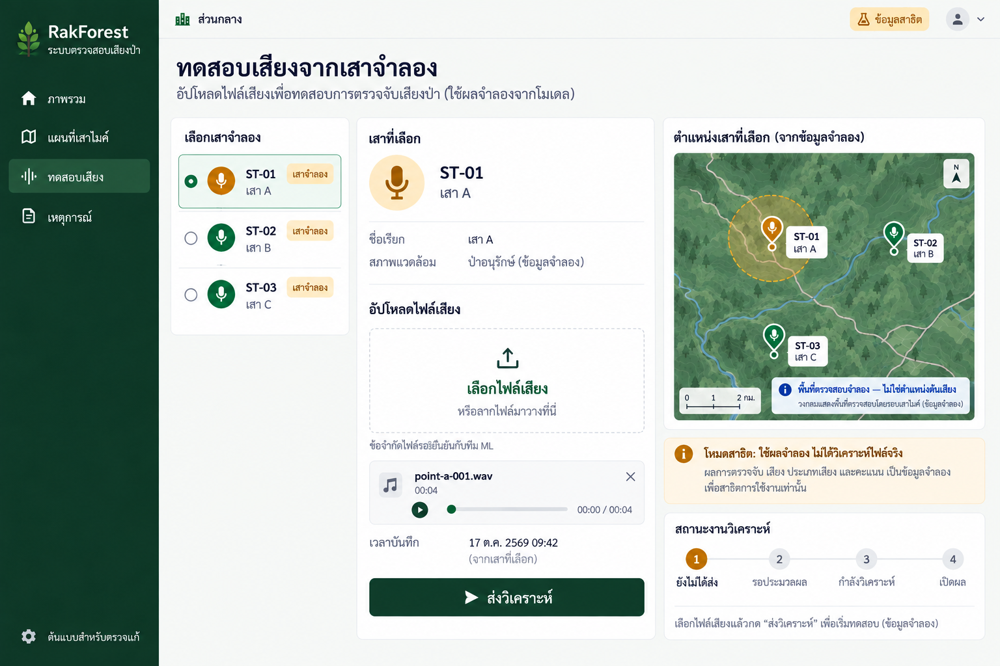
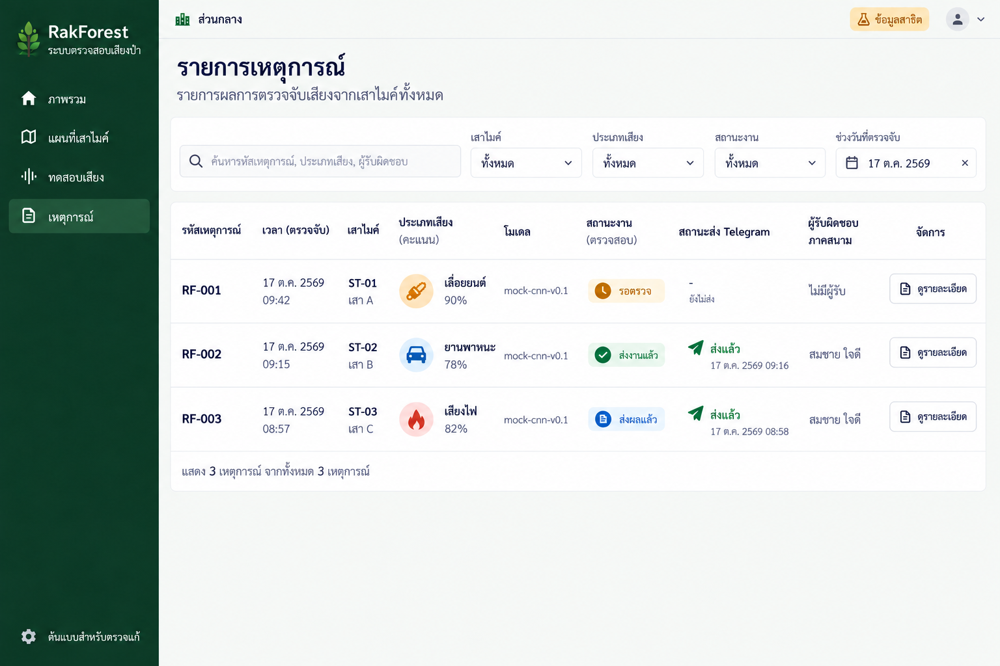
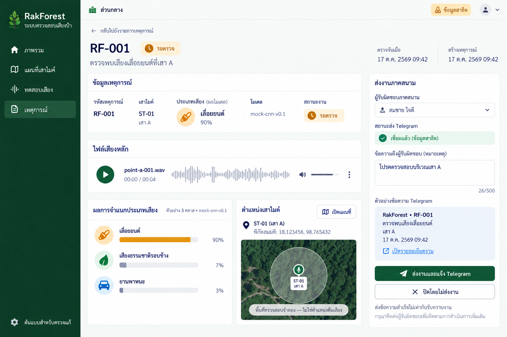
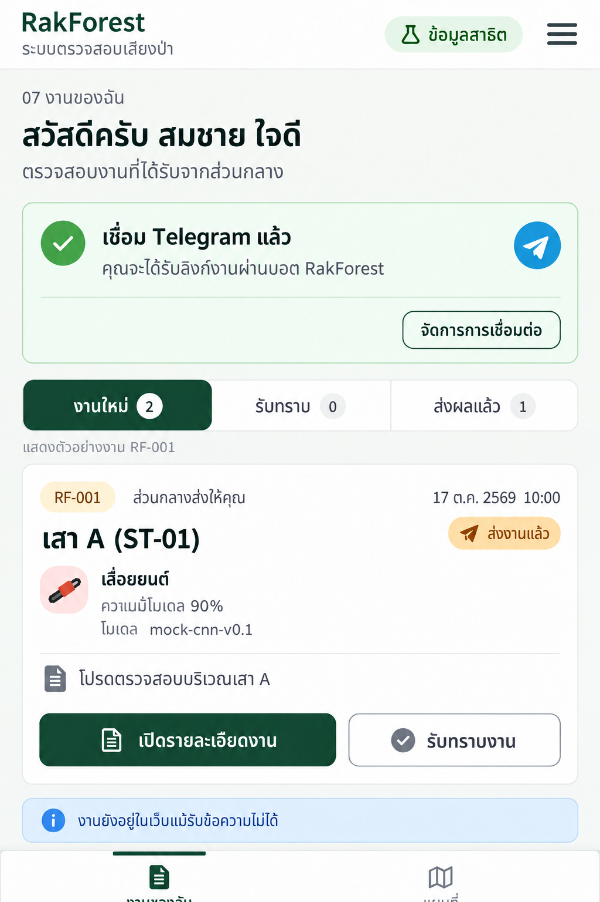
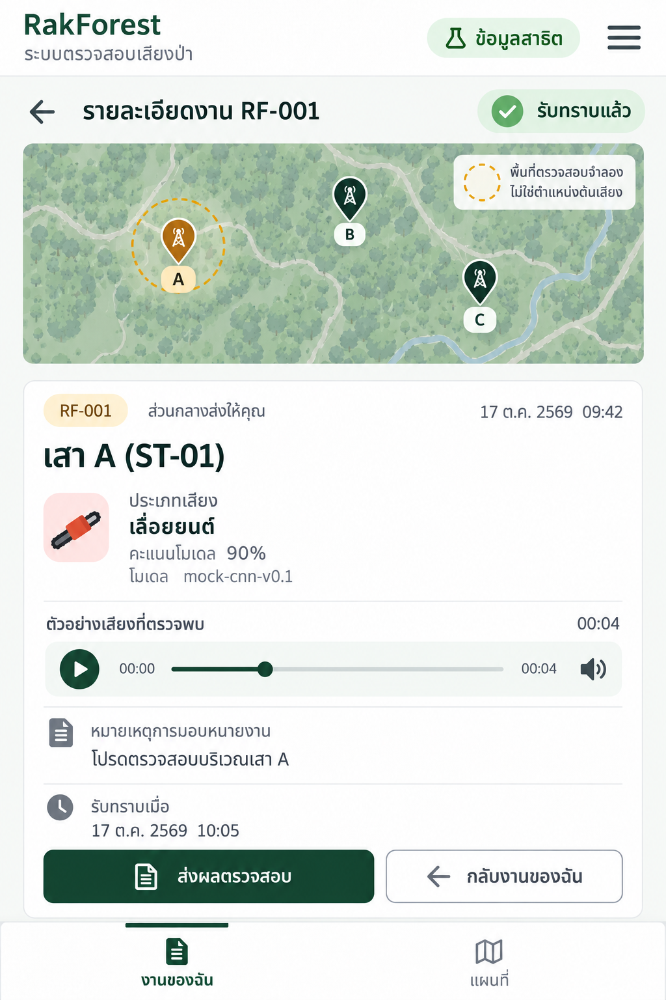
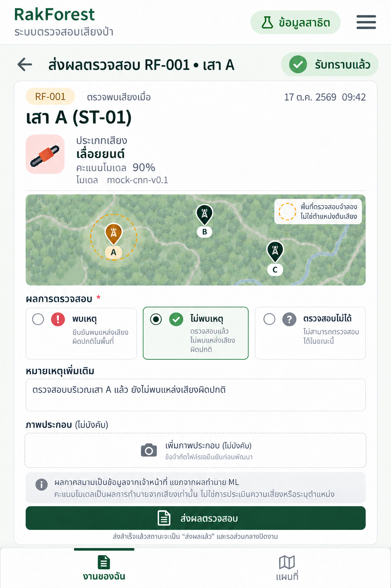

# RakForest — ภาพต้นแบบ v2: สองบทบาทและ Telegram

17 ตุลาคม 2569

## สถานะส่งมอบ

ภาพต้นแบบ9หน้าและแกลเลอรีสำหรับตรวจแก้ก่อนเขียนเว็บ ตามขั้นตอนแรกที่ตกลง ไม่มีแอปทำงาน ไม่มี Supabase/โมเดลจริง และยังไม่ได้สร้างบอตหรือส่ง Telegram จริง ภาพสร้างด้วย built-in imagegen; รุ่นv1เก็บไว้ต่างหาก

## เส้นทางสาธิต

01เข้าสู่ระบบ → 04เลือกเสาจำลองและส่งเสียง → ML/mockผลจำแนก → 03แผนที่/05เหตุการณ์ → 06ส่วนกลางตรวจแล้วส่งงาน → Telegramส่งลิงก์ → 07รับงาน → 08รับทราบและดูแผนที่ → 09ส่งผล → 06ส่วนกลางปิดงาน

RF-001: ST-01 เสา A, เสียงเลื่อยยนต์90%, mock-cnn-v0.1 ตรวจพบ17ต.ค.2569 09:42 ส่งงาน10:00 รับทราบ10:05; ผลภาคสนามตัวอย่างไม่พบเหตุ ไม่เท่ากับยืนยันโมเดลผิดเสมอไป ต้องพิจารณาหลักฐานและเวลาตรวจ

ภาพ02–06แสดงก่อนมอบหมาย RF-001; ภาพ07–09แสดงขั้นต่อมา จึงมีสถานะต่างกันโดยตั้งใจ RF-002 เสา B ยานพาหนะ78% เวลา09:15 ส่ง09:16; RF-003 เสา C เสียงไฟ82% เวลา08:57 ส่ง08:58และส่งผลแล้ว

## 01 เข้าสู่ระบบ

เข้าสู่ระบบแล้วเปิดหน้าตามบทบาท ไม่มีสมัครบัญชีหรือ OTP

**การใช้งาน:** เข้าสู่ระบบ → ส่วนกลาง02 / ภาคสนาม07

**สถานะเพิ่มเติม:** กำลังตรวจบัญชี: ปิดปุ่มซ้ำ; บัญชีผิด/ไม่มีสิทธิ์: ข้อความภาษาไทย ไม่เปิดหน้าข้อมูล

## 02 ภาพรวมส่วนกลาง

ภาพรวมก่อนส่ง RF-001: รอตรวจ1 ส่งงานแล้ว1 ส่งผลแล้ว1 เสาจำลอง3

**การใช้งาน:** เลือกเหตุ →06; ทดสอบเสียง→04; เมนูแผนที่→03

**สถานะเพิ่มเติม:** Loading: skeleton; Empty: ตัวเลข0; Error: ปุ่มลองใหม่ ห้ามใช้ค่าศูนย์แทนข้อมูลที่โหลดล้มเหลว

## 03 แผนที่เสาไมค์

หมุดเสา A/B/C และวงพื้นที่ตรวจสอบจำลอง RF-001 ยังไม่มอบหมาย

**การใช้งาน:** เลือกเสา→แผงรายละเอียด; เปิดเหตุการณ์→06

**สถานะเพิ่มเติม:** ไม่มีเหตุการณ์: ยังเห็นเสา; แผนที่ล้มเหลว: แสดงรายการเสาและทางไปรายการเหตุการณ์

## 04 เสาและอัปโหลดเสียงทดสอบ

เลือกเสาแล้วอัปโหลดเสียงแทนฮาร์ดแวร์จริง ใช้ผลจำลองจนกว่าโมเดลพร้อม

**การใช้งาน:** ส่งวิเคราะห์→queued→processing→succeeded→06; failed→ลองใหม่

**สถานะเพิ่มเติม:** ปิดปุ่มส่งระหว่างดำเนินการ; ไฟล์ไม่รองรับให้แจ้งเหตุผล; ไม่แสดงผลจำลองเป็นการวิเคราะห์จริง

## 05 รายการเหตุการณ์

RF-001 รอตรวจ / RF-002 ส่งงานแล้ว / RF-003 ส่งผลแล้ว แยกสถานะงานและ Telegram

**การใช้งาน:** กรอง/ค้นหา; ดูรายละเอียด→06

**สถานะเพิ่มเติม:** Loading: skeleton; Empty: ไม่มีรายการหรือไม่ตรงตัวกรอง; Error: ลองใหม่

## 06 รายละเอียดและส่งงาน

RF-001 ก่อนมอบหมาย ผู้รับที่เลือกยังไม่ถือว่ารับงาน จนกดส่งและบันทึกสำเร็จ

**การใช้งาน:** ส่งงานและแจ้ง Telegram→บันทึกงาน+คิวส่ง; ปิดโดยไม่ส่ง→ต้องมีเหตุผล; เปิดแผนที่→03

**สถานะเพิ่มเติม:** ส่งไม่สำเร็จ: งานยังอยู่ พร้อมปุ่มลองส่งข้อความใหม่; ไม่เชื่อมบอต: แสดงคำอธิบาย ไม่อ้างส่งถึงแล้ว; เมื่อส่งผลกลับ: แสดงผลและปุ่มปิดงาน

## 07 งานของฉัน

หลังส่ง RF-001 เวลา10:00 ภาคสนามเห็นงานของตน ภาพแสดงตัวอย่างงานเดียวและการเชื่อม Telegram สำเร็จ

**การใช้งาน:** เปิดรายละเอียด→08; รับทราบ→สถานะacknowledged; เชื่อม Telegram เมื่อยังไม่เชื่อม→เปิดบอตพร้อมรหัสใช้ครั้งเดียว

**สถานะเพิ่มเติม:** ยังไม่เชื่อม: ปุ่มเชื่อม Telegram และคำอธิบายกดStart; หมดอายุ: สร้างรหัสใหม่; ไม่มีงาน: ข้อความรอรับงาน

## 08 รายละเอียดงานและแผนที่

หลังรับทราบ RF-001 เวลา10:05 เห็นตำแหน่งเสา ข้อความส่วนกลาง และเสียง

**การใช้งาน:** ส่งผลตรวจสอบ→09; กลับงาน→07; แท็บแผนที่แสดงเฉพาะงานที่มีสิทธิ์

**สถานะเพิ่มเติม:** ไม่พบงาน/ไม่มีสิทธิ์: ไม่เปิดข้อมูล; เสียงโหลดไม่ได้: ลองใหม่โดยยังอ่านรายละเอียดได้

## 09 ส่งผลตรวจสอบ

ฟอร์มก่อนส่งผล RF-001 เลือกไม่พบเหตุ ตัวเลือกอื่นคือพบเหตุและตรวจสอบไม่ได้ ภาพประกอบไม่บังคับ

**การใช้งาน:** ส่งผล→submitted; ส่วนกลางเปิด06ตรวจผลและปิดงาน→closed

**สถานะเพิ่มเติม:** ต้องเลือกผล; ส่งอยู่ปิดปุ่มซ้ำ; ล้มเหลวเก็บข้อความ/ไฟล์ไว้ในหน้าปัจจุบัน ไม่อ้างว่าส่งแล้ว ไม่รับประกันเก็บหลังปิดเว็บ

## ขอบเขตพัฒนาเมื่อผ่านรอบตรวจภาพ

- Next.js + TypeScript + Tailwind/shadcn, Supabase Auth/DB/private Storage, MapLibre; บัญชี2บทบาทเตรียมไว้ ไม่สมัคร/OTP
- URL ส่วนกลางใช้ /office/* ภาคสนาม /field/* และ /login เพื่อไม่ให้ route ของสองบทบาทชนกัน
- แยก service ข้อมูล/วิเคราะห์เสียง/แจ้งเตือน และใช้ mock fixtures แบบแน่นอนก่อน ยังไม่สุ่มผลแล้วอ้างว่าเป็นผลจากไฟล์
- Station: id, name, coordinates, demoInspectionRadiusMeters, isDemo; รัศมีเป็นค่าจำลองไม่ใช่ระยะไมค์หรือสูตรจากคะแนน ML
- AnalysisJob: id, stationId, audioPath, recordedAt, status queued/processing/succeeded/failed, predictionId, error
- Prediction: id, jobId, predictedLabel, scores, modelVersion, processedAt, isDemo; คะแนน0–1 เว็บแปลงเป็น% ไม่ฝังจำนวนคลาสตายตัว
- Incident: id, predictionId, status pending/dispatched/acknowledged/submitted/closed, assigneeId, dispatchNote, timestamps, closeReason
- FieldResult: incidentId, outcome found/not_found/unable_to_inspect, notes, evidencePaths, submittedBy, submittedAt
- TelegramLink: userId, privateChatId เก็บฝั่งเซิร์ฟเวอร์; LinkToken เก็บhash/expiry/usedAt; Notification เก็บ incidentId, recipientId, status queued/accepted/failed, attempt, providerMessageId, error
- Interface หลัก: listStations, submitAudio, getAnalysisJob, listIncidents, getIncident, dispatchIncident, acknowledgeIncident, submitFieldResult, closeIncident, createTelegramLink, retryNotification
- เก็บเวลาISOพร้อมtimezone แสดงAsia/Bangkok; บันทึกผลทุกหน้าจากข้อมูลเดียวกันและrefreshหลังเปลี่ยนสถานะ
- ภาคสนามอ่าน/แก้เฉพาะงานที่ได้รับ ส่วนกลางอ่านทั้งหมด สิทธิ์ต้องบังคับบนเซิร์ฟเวอร์/RLS และไฟล์privateด้วย ไม่พึ่งซ่อนปุ่ม
- งานที่ส่งข้อความล้มเหลวยังคงdispatchedและอยู่ในงานของผู้รับ แสดงข้อผิดพลาดให้ส่วนกลาง retry เฉพาะข้อความ ไม่สร้างงานใหม่
- ส่วนกลางปิดpendingโดยมีเหตุผล หรือปิดsubmittedหลังตรวจผล; ไม่เพิ่มการเปลี่ยนผู้รับ/เปิดงานใหม่ในv1

## Telegram ที่จะเชื่อมจริง

1. ผู้ดูแลสร้างbotผ่านBotFatherและตั้ง token/server webhook secret เป็น environment ฝั่งเซิร์ฟเวอร์ ไม่ใส่NEXT_PUBLICและไม่เก็บในrepo
2. ผู้ใช้เข้าสู่เว็บ กดเชื่อม รับdeep linkพร้อมรหัสสุ่มใช้ครั้งเดียวอายุ10นาที เก็บเฉพาะhashในฐานข้อมูล
3. กดStartในprivate chat; webhookตรวจsecret, update_idซ้ำ, chat type, รหัสยังไม่หมดอายุ/ไม่ใช้แล้วก่อนผูกกับบัญชี ใช้รหัสแบบatomicเพื่อกันใช้ซ้ำ
4. ส่วนกลางdispatchแล้วเขียนงานและoutboxในtransaction; unique dispatch key ป้องกันดับเบิลคลิก ตัวส่งใช้การclaimรายการเพื่อกันประมวลผลพร้อมกัน
5. sendMessageส่งรหัสงาน ประเภทเสียง เสา เวลา และปุ่มURLไปหน้ารายละเอียดเว็บ ตรวจsession/assigneeทุกครั้ง ไม่ใส่signed media URLหรือสิทธิ์เข้าถึงในข้อความ
6. สำเร็จหมายถึงAPIรับคำขอ ไม่ใช่อ่านแล้ว หากtimeoutและผลไม่แน่นอนให้แสดงสถานะตรวจสอบการส่ง ไม่รับประกันexactly-onceของผู้ให้บริการและไม่retryรัว
7. blocked chat/invalid link/429 ต้องแสดงเหตุผลตามสมควรและเคารพretry_after; fieldรับทราบและส่งผลผ่านเว็บเท่านั้น

รอบจริงต้องมีบัญชีSupabase, bot token, ชื่อbot และHTTPS URL สำหรับwebhook รวมถึงไฟล์เสียง/endpointโมเดลจากทีม ยังไม่ได้ขอหรือใช้ข้อมูลเหล่านี้ในรอบภาพ

อ้างอิง: https://core.telegram.org/bots และ https://core.telegram.org/bots/api

## เกณฑ์ทดสอบหลังพัฒนา

- อัปโหลด→ผลจำแนก→ส่วนกลางตรวจ→ส่งTelegramถึงมือถือ→เปิดเว็บ→รับทราบ→ส่งภาพ/ผล→ส่วนกลางปิดงาน
- ไฟล์ผิด, งานวิเคราะห์ล้มเหลว, กดส่งซ้ำ, โมเดลยังไม่พร้อม, ผลไม่มีเหตุการณ์, ข้อมูลว่าง
- ผู้รับยังไม่เชื่อมบอต, tokenเชื่อมหมดอายุ/ใช้ซ้ำ, webhookไม่ถูกต้อง/ส่งซ้ำ, botถูกblock, providerล้มเหลว
- เปิดURLงานคนอื่น, เข้าถึงไฟล์คนอื่น, ภาคสนามพยายามเปลี่ยนassignee/statusที่ไม่ได้รับอนุญาต
- อินเทอร์เน็ตหลุดระหว่างส่งภาพ/ผล: ไม่อ้างสำเร็จ ไม่สร้างผลซ้ำ; เมื่อกลับมาให้ลองใหม่
- เปลี่ยนสถานะแล้วDashboard/ตาราง/แผนที่ตรงกัน สีต้องมีข้อความกำกับ ใช้keyboardได้ และresponsive

## ข้อจำกัดของภาพและสิ่งที่ให้ยึดตอนพัฒนา

ภาพเป็นrasterเพื่อพิจารณาองค์ประกอบ ยังไม่ใช่หน้าจอจากโค้ด แผนที่แต่ละภาพเป็นภาพประกอบภูมิประเทศสมมติ ตำแหน่งบนภาพไม่ใช่ข้อมูลGIS ใช้Station datasetเดียวเมื่อเขียนเว็บจริง

ไอคอน สีสถานะ ตัวนับข้อความ หรือสเกลที่เครื่องมือวาดไม่ถือเป็นข้อกำหนดใหม่ ใช้คะแนนโมเดลเป็นคำหลัก ไม่แปลงเป็นความเสี่ยงไฟป่า ข้อจำกัดไฟล์เสียง/ภาพต้องตกลงก่อนเชื่อมจริง

รอบนี้ยังไม่ทำฮาร์ดแวร์ หาตำแหน่งต้นเสียง พยากรณ์ไฟป่า Offline PWA LINE/SMS หรือระบบบริหารโซนขนาดใหญ่

เสนอแก้โดยบอกหมายเลขหน้า + ส่วนที่ต้องการเปลี่ยน เช่น หน้า03ลดขนาดแผงข้อมูล / หน้า07ขยายปุ่มรับทราบ

